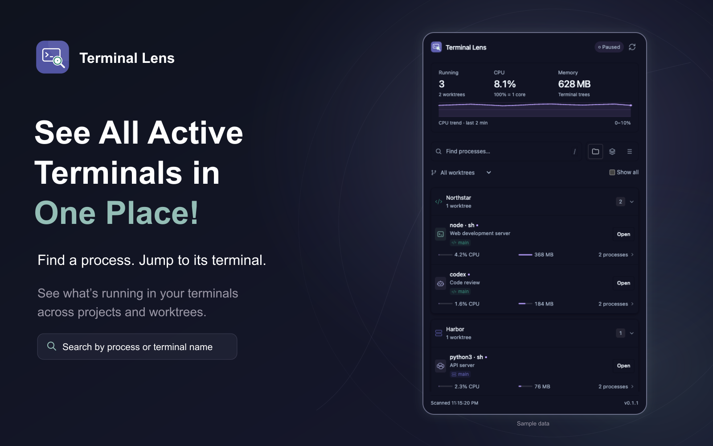

# Terminal Lens

**Find the process. Jump to its terminal.**

Find processes running in your terminals inside [Orca](https://orca.dev). Search across projects and worktrees, see their current activity in a compact sidebar, and open the exact terminal pane from a result. Process discovery works across executables without a runtime allowlist.

[](https://orca.dev) [](#features) [](LICENSE)



Version **0.1.2**. The release process is documented in [RELEASE.md](RELEASE.md).

## Install

Requires **Orca desktop 1.4.260 or newer**, its compatible CLI, and a **macOS or Linux host**. See [compatibility](COMPATIBILITY.md) for supported terminals and process ownership limits.

Install a versioned release:

1. Open **Settings → Plugins**.
2. Choose **Add plugin → From a Git URL…** and enter:

   ```text
   https://github.com/faisalmuhammad/orca-terminal-lens#v0.1.2
   ```

   Keep `#v0.1.2` at the end to install the release tag.
3. Review and approve the **trusted worker**, **workspace discovery and navigation**, and **terminal read** access.
4. Open **Terminal Lens** from the terminal icon in the sidebar.

All runtime assets are included. Installation needs no separate Node.js installation, dependencies, or build step. GitHub releases use tagged repository content without attached archives.

CLI alternative:

```sh
orca plugin install faisalmuhammad/orca-terminal-lens@v0.1.2 --json
```

For local use before publication, add the plugin folder through **Settings → Plugins → Development folders…**. The cover renders the actual panel with fictional sample data; its uniform dark background and glow are image treatments. See [artwork provenance](assets/README.md).

## Use

Start a command in a local Orca terminal. Search by process name, terminal title, project, worktree, or branch. Click a row or its bordered **Open** button to focus the exact pane running that process. Expand process details independently.

Switch between **Project**, **Worktree**, and **Flat List** using the icons beside search. Groups collapse, recent terminals rise to the top, and flat rows include project and worktree names. The scope menu limits results to the current worktree; **Show all** includes idle and unknown terminals.

**Live** scans every 10 seconds while the panel is visible. The refresh button scans immediately. CPU and memory context helps distinguish active terminals; unavailable measurements stay unknown.

Press **/** to search, **Escape** to clear search, and **Enter** or **Space** to open a focused row.

## Features

| Feature | Behavior |
| --- | --- |
| Process discovery | Find foreground and background descendants of local terminal shells |
| Search and scope | Find matching processes and terminals across projects or within the current worktree |
| Direct navigation | Click a result or Open to focus its exact terminal pane |
| Three views | Organize by project, by worktree, or as a flat terminal list |
| Recent first | Terminal and group order follows recent access |
| Process identity | Distinctive icons and colors, with neutral fallbacks |
| Resource context | CPU trend, memory meters, and expandable process details |
| Refresh | Visible-panel live scans and manual refresh |
| Theme support | Orca theme colors and native worktree appearance |
| Compact layout | Fixed header, chart, filters, and footer; list-only scrolling and accessible entry animations |

CPU at 100% represents one core. The chart uses measured samples from the latest 30 successful scans. See [the usage guide](docs/usage.md) for refresh, resource interpretation, and troubleshooting.

## Access and privacy

| Access | Purpose |
| --- | --- |
| Trusted worker | Query local process ownership and Orca navigation metadata on the host |
| `workspace:read` | Discover projects, worktrees, and their terminal panes |
| `workspace:write` | Focus the matching worktree and terminal pane |
| `terminal:read` | Read terminal metadata needed for process ownership; CLI previews are discarded |

The worker runs with your user account's authority on the Orca host. Process queries read executable names and PIDs without requesting command arguments or environment variables.

The plugin makes no telemetry or network requests. Results stay in local memory apart from the saved view preference. It does not start, stop, or send input to processes. Remote or ambiguous ownership remains Unknown. See [access and data handling](docs/PRIVACY.md) and [compatibility](COMPATIBILITY.md).

<details>
<summary>Local development and validation</summary>

Requires **Node.js 22+**, npm, and a compatible Orca desktop CLI.

```sh
npm ci
npm run check
orca plugin validate . --json
```

Set `ORCA_CLI_COMMAND` when the compatible Orca executable is not on your PATH.

```sh
orca plugin dev load . --json
orca plugin open local.running-terminals --panel running-terminals --json
```

Tests use controlled process, navigation, and publication fixtures. The GitHub workflow checks macOS and Linux and validates the manifest with a pinned official Orca CLI on macOS. See [compatibility](COMPATIBILITY.md) for ownership and recency limits.

Listing artwork is committed in assets/. `npm run release:check` verifies publication files, image budgets, versions, and sensitive local text. The clean GitHub export is created by `npm run release:export`; see [the upload guide](docs/github-upload.md).

To prepare a release, change the manifest version and add its changelog entry, then run `npm run release:prepare` and `npm run check`. Commit and push or merge to main; GitHub Actions creates the matching tag and release after validation. Existing releases are preserved.

Select [assets/social.png](assets/social.png) for GitHub's Social preview setting. See [RELEASE.md](RELEASE.md), [Contributing](CONTRIBUTING.md), and [Changelog](CHANGELOG.md) for development and publication details.

</details>

## Attribution and license

An unofficial community plugin maintained by [faisalmuhammad](https://github.com/faisalmuhammad). Plugin code and original artwork use [MIT](LICENSE).

Orca remains the property of its authors. Development tooling and CI references are described in [third-party notices](THIRD_PARTY_NOTICES.md).
